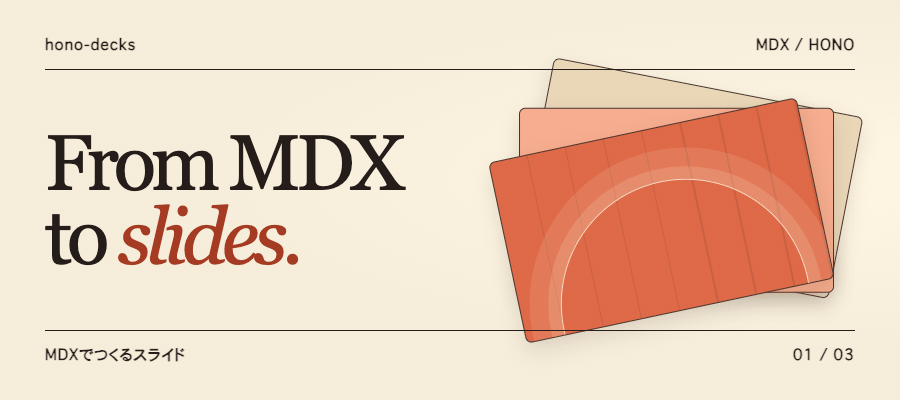

# T.S.

スライド、ドキュメント、開発環境のためのOSSを作っています。

[Portfolio ↗](https://tslab.app/)

## hono-decks

MDXで書いたスライドを、HonoやCloudflare Workersで配信するツールです。

[デモを見る ↗](https://hono-decks.com/demo/product) · [ドキュメント ↗](https://hono-decks.com/) · [GitHub ↗](https://github.com/ts-76/hono-decks)

## Selected projects

- [**void-plugin-hono-jsx**](https://github.com/ts-76/void-plugin-hono-jsx) — VoidでHono JSXを使うためのプラグイン。
- [**honoxpress**](https://github.com/ts-76/honoxpress) — Honoアプリにナビゲーションや目次付きのドキュメントを追加するツール。
- [**ghq-sector**](https://github.com/ts-76/ghq-sector) — `ghq` で管理するリポジトリを用途別に整理するCLI。
